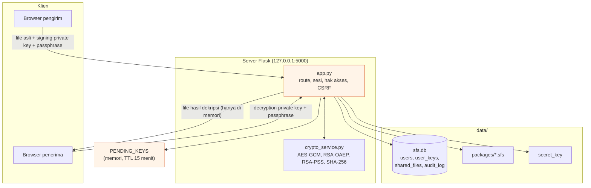
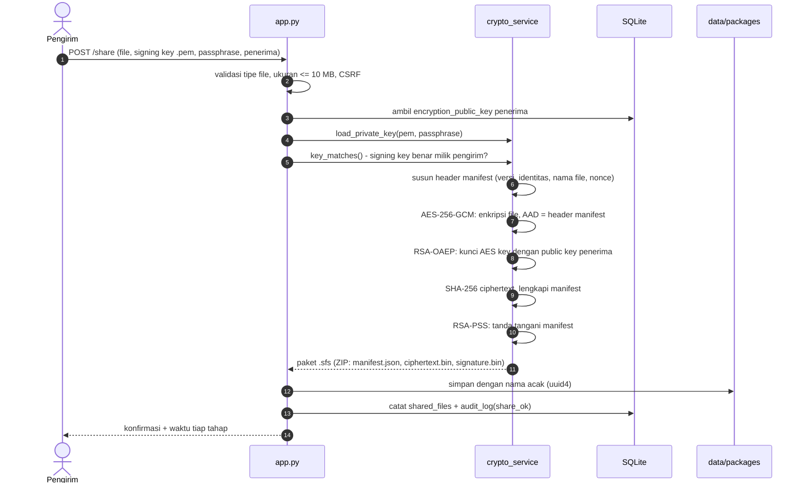
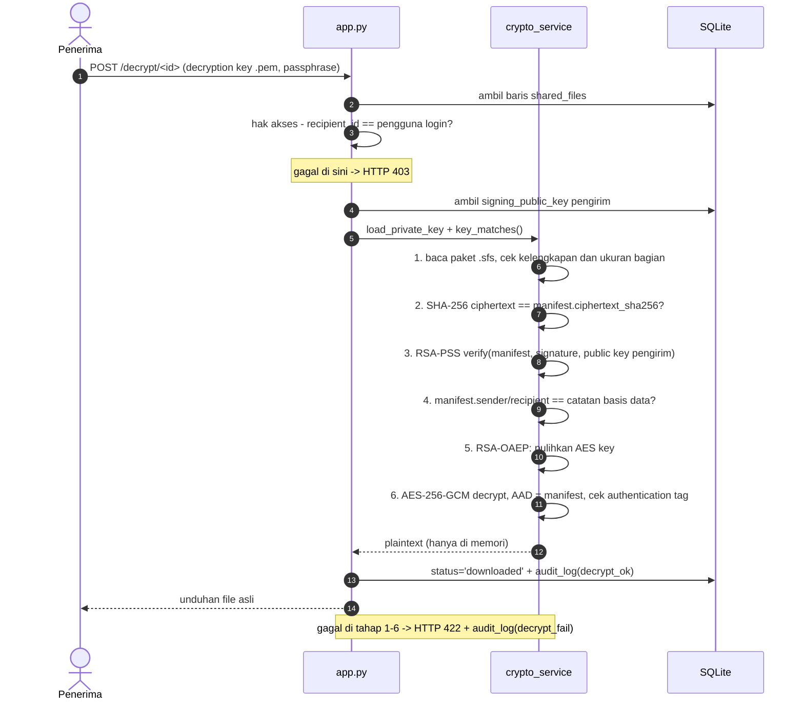

# Arsitektur dan Alur Sistem

Dokumen ini memuat diagram untuk bagian perancangan laporan. Blok `mermaid`
dirender otomatis di GitHub/GitLab; bila perlu gambar untuk dokumen cetak,
tempel kodenya ke <https://mermaid.live> dan ekspor PNG/SVG.

---

## 1. Arsitektur sistem



Kotak berwarna menandai titik di mana server memegang data sensitif dalam
bentuk terbuka. Inilah sebabnya sistem ini **bukan end-to-end encryption**
(lihat `pemilihan-algoritma.md` bagian 4 dan README bagian Batasan).

---

## 2. Alur pengiriman (enkripsi dan penandatanganan)



## 3. Alur penerimaan (verifikasi dan dekripsi)

Urutan ini berhenti pada kegagalan pertama, dan tahap yang gagal
ditampilkan ke pengguna.



---

## 4. Struktur basis data

```mermaid
erDiagram
    users ||--o| user_keys : "memiliki satu pasang"
    users ||--o{ shared_files : "mengirim"
    users ||--o{ shared_files : "menerima"
    users ||--o{ audit_log : "mencatat"

    users {
        INTEGER id PK
        TEXT username UK
        TEXT email UK
        TEXT password_hash
        TEXT created_at
    }
    user_keys {
        INTEGER id PK
        INTEGER user_id FK_UK
        TEXT encryption_public_key
        TEXT signing_public_key
        TEXT created_at
    }
    shared_files {
        INTEGER id PK
        INTEGER sender_id FK
        INTEGER recipient_id FK
        TEXT original_filename
        TEXT stored_filename
        INTEGER file_size
        TEXT package_path
        TEXT created_at
        TEXT status
    }
    audit_log {
        INTEGER id PK
        TEXT created_at
        INTEGER user_id
        TEXT username
        TEXT action
        INTEGER file_id
        TEXT detail
        TEXT ip
    }
```

Private key **tidak pernah** masuk ke tabel mana pun. Satu-satunya salinan di
server ada di `PENDING_KEYS` (memori proses) selama 15 menit setelah kunci
dibuat, agar pengguna sempat mengunduhnya.

---

## 5. Format paket `.sfs`

```
paket.sfs  (arsip ZIP, ZIP_STORED / tanpa kompresi)
|
+-- manifest.json     JSON kanonik (kunci terurut, tanpa spasi)
|     version              = 2
|     sender, recipient    identitas, dicocokkan dengan basis data
|     original_filename
|     sent_at
|     nonce                96 bit, base64, acak per file
|     algorithms           keterangan algoritma yang dipakai
|     encrypted_aes_key    AES key 256 bit dibungkus RSA-OAEP-SHA256
|     ciphertext_sha256    hash heksadesimal ciphertext
|
+-- ciphertext.bin    AES-256-GCM(plaintext), authentication tag 16 byte
|                     menempel di akhir. AAD = manifest tanpa field
|                     encrypted_aes_key dan ciphertext_sha256.
|
+-- signature.bin     RSA-PSS-SHA256 atas byte manifest.json
```

Dua lapis integritas yang saling melengkapi:

| Lapis | Melindungi | Gagal bila |
|---|---|---|
| `ciphertext_sha256` + RSA-PSS | seluruh paket, termasuk asal pengirim | ciphertext atau manifest diubah tanpa signing key pengirim |
| AAD AES-256-GCM | ikatan ciphertext ke isi manifest | manifest diubah lalu ditandatangani ulang oleh pemegang signing key |

Tanpa lapis AAD, pemegang signing key pengirim dapat memasangkan ciphertext
dengan manifest lain (mengubah nama file atau identitas penerima) dan paket
tetap lolos semua pemeriksaan.
